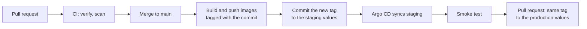
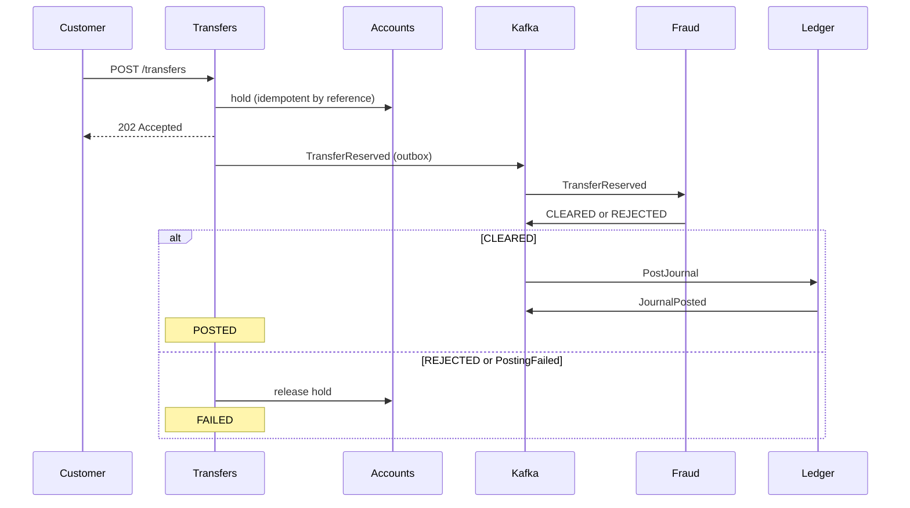

<!-- GENERATED by scripts/build.py from 16.2-deployment-adrs-runbook/lesson.md, cbt.json and lms/videos.json. Edit the source, then run `python scripts/build.py`. -->


# 16.2 Live deployment on Kubernetes with CI/CD; ADRs, runbook and architecture diagrams

← [16.1 Capstone build](../16.1-capstone-build/README.md) · [Module 16](../README.md) · [Phase 3](../../README.md) · [16.3 Observability dashboard and load-test report](../16.3-observability-and-load-report/README.md) →

> **Week 36** · Module 16: Capstone, System Design & Interview Prep · Website topic covered: *Live deployment on Kubernetes with CI/CD, architecture decision records, a runbook and architecture diagrams*

## What you will be able to do

- Build a pipeline that takes a commit to a running Kubernetes cluster: test, scan, push an image tagged with the commit, and deploy through GitOps.
- Roll back a bad release in one step, and change a database schema without breaking a rolling deployment.
- Keep architecture decision records (ADRs) a newcomer can follow, including the ones you've changed your mind about.
- Draw the diagrams reviewers expect: C4 context and container views, and a sequence diagram of the saga.
- Write a runbook that someone who has never seen the system can follow during an incident.

## Why this matters in a bank or fintech

In a bank, a change reaches production only with evidence: who made it, who reviewed it, what was tested, and how to undo it. Auditors ask for that trail, and change-management boards ask for the rollback plan before they ask for anything else. The same documents are what let a new engineer, or an on-call engineer at 3 a.m., understand a system they didn't build. For you, they're also the best interview material you have: a clear ADR answers "why did you do it that way?" before anyone asks.

## 1. From commit to cluster

Module 12 deployed ITL Pay with Argo CD from Git; Phase 2 built pipelines that test and scan. `v1.0` joins them:



The steps on `main`, in GitHub Actions:

```yaml
jobs:
  release:
    runs-on: ubuntu-latest
    permissions: { contents: write, packages: write }
    steps:
      - uses: actions/checkout@v5
      - uses: actions/setup-java@v5
        with: { distribution: temurin, java-version: "21", cache: maven }
      - run: ./mvnw -B verify                                   # every service, with Testcontainers
      - uses: docker/login-action@v3
        with: { registry: ghcr.io, username: "${{ github.actor }}", password: "${{ secrets.GITHUB_TOKEN }}" }
      - name: Build, scan and push each image
        run: |
          for svc in gateway accounts transfers ledger fraud notifications rates assistant interest-batch; do
            image=ghcr.io/${{ github.repository_owner }}/itl-pay-$svc:${GITHUB_SHA::12}
            docker build -t "$image" "$svc"
            docker run --rm -v /var/run/docker.sock:/var/run/docker.sock aquasec/trivy:0.75.0 \
                image --exit-code 1 --severity CRITICAL --ignore-unfixed "$image"
            docker push "$image"
          done
      - name: Deploy to staging through Git
        run: |
          yq -i ".global.image.tag = \"${GITHUB_SHA::12}\"" deploy/helm/itl-pay/values-staging.yaml
          git config user.name "release-bot" && git config user.email "release-bot@users.noreply.github.com"
          git commit -am "Deploy ${GITHUB_SHA::12} to staging" && git push
```

Three choices matter:

- **Tag images with the commit, never `latest`.** `itl-pay-transfers:3f9c2a1b7d40` always means the same bytes, so you know exactly what's running and can go back to it. A `latest` tag that moves under you makes "what's in production?" unanswerable.
- **The pipeline doesn't touch the cluster.** It commits the new tag to Git; Argo CD, inside the cluster, applies it. The cluster's credentials never leave the cluster, and every deployment is a commit with an author.
- **Promotion is a pull request.** Production gets the same image that passed staging and the smoke test, by changing the tag in `values-production.yaml`. Someone reviews it; that review is your change approval.

For `v1.0` one cloud environment is enough (call it production, and use kind as staging). It must stay up for your defence: a k3s VPS for a few weeks costs far less than a managed cluster, which you'd create for the defence day only.

## 2. Rolling back

When a release is bad, **roll back first and diagnose later** (topic 13.5). With GitOps, rolling back is reverting the commit that changed the tag:

```bash
git revert --no-edit <commit-that-deployed-the-bad-tag>
git push                                    # Argo CD rolls the previous image back out
```

Practise it before you need it, and time it. Argo CD's own history and `helm rollback` also work, but if the change isn't in Git, Argo CD's self-heal puts the bad version straight back.

**The catch is the database.** Rolling the code back doesn't roll a migration back, and during a rolling deployment the old and new versions run at the same time against the same schema. So every schema change must work with both. Use **expand and contract**:

1. **Expand:** add the new column (nullable, or with a default) in release N. Old code ignores it; new code writes both old and new.
2. **Migrate:** backfill the new column in a batch.
3. **Contract:** in release N+1 or later, once nothing reads the old column, drop it.

Never rename or drop a column in the same release as the code that stops using it. Flyway migrations only go forwards; a "rollback" is a new migration.

## 3. Architecture decision records

An **ADR** records one significant decision: the context, what you decided, and what follows from it. You've written ten during this phase. For `v1.0`, make them a set someone can use.

The common format (Michael Nygard's):

```markdown
# ADR 4: Publish events through a transactional outbox

Status: Accepted (2026-09-14). Supersedes: none.

## Context
Transfers must change state and publish an event together. Saving and then sending can lose the event
if the service stops in between; sending and then saving can publish an event for a change that never happened.

## Decision
Each state change and its event are written in one database transaction; a relay publishes the outbox to Kafka.

## Consequences
- No lost or phantom events; consumers must be idempotent, because the relay can publish twice.
- Events are delayed by the relay: 3 s at the oldest under the 60/s load test (13.5); we alert at 30 s.
- One more table and one more moving part to operate (runbook: OutboxStuck).
```

Rules that make ADRs useful:

- **Keep them short** (a page) and **in the repository**, in `docs/adr/`, numbered, next to the code they explain.
- **Never edit an accepted decision away.** When you change your mind, write a new ADR that **supersedes** the old one and mark the old one *Superseded by ADR 12*. The history of why is the valuable part.
- **Write the consequences honestly**, including the bad ones and the numbers.
- **Keep an index** in `docs/adr/README.md`: number, title, status, one line.

For `v1.0`, add **ADR 11: how a release reaches production and how it's rolled back** (the pipeline, the promotion, the rollback, expand-and-contract), and review ADRs 1–10: some will be out of date by now.

## 4. Diagrams

Reviewers and interviewers want a few diagrams that each answer one question, not one diagram that answers all of them. The **C4 model** gives you levels of zoom:

| Level | Shows | For ITL Pay |
| --- | --- | --- |
| 1. System context | The system as one box, its users and the systems around it | Customers, support staff, ITL Pay, the identity provider, the SMS provider, the FX provider, the model provider |
| 2. Container | The deployable parts and how they talk | The gateway, each service and its database, Kafka, Redis, the batch job |
| 3. Component | Inside one container | Transfers: controller, saga, outbox, relay, client to accounts |

Levels 1 and 2 are enough for most readers; draw level 3 only for the service you'd most like to talk about. Add one **sequence diagram** for the transfer saga, with the failure path, because that's the question you'll be asked:



Keep diagrams as code (Mermaid renders on GitHub; Structurizr and PlantUML are common in banks), so they change in the same pull request as the code, and give each a title and a legend.

## 5. The runbook

A **runbook** tells someone who didn't build the system what to do when something specific happens. Write it for a tired colleague who has never seen the code. One entry per paging alert, plus the routine operations:

| Entry | When it's used |
| --- | --- |
| Each paging alert (error budget burn, slow transfers, outbox stuck, consumer lag, breaker open) | The alert fires |
| Deploy and promote | Every release |
| Roll back | A release is bad |
| Replay a dead-letter message | A message is stuck in a DLT (Module 11) |
| Restore a database | Data lost or corrupted |
| Rotate a secret | A secret leaked, or on schedule |
| Rerun the end-of-day batch | The batch failed part-way |

Each alert entry has the same parts:

```markdown
## OutboxStuck

**What it means:** the oldest unpublished event in transfers' outbox is older than 30 seconds. Customers' transfers
are recorded but not progressing; they see "pending".
**Impact:** transfers delayed, not lost. No money moves wrongly.
**Check:**
1. Dashboard "ITL Pay", panel "Outbox oldest age": rising steadily (relay stopped) or in waves (relay too slow)?
2. `kubectl -n itl-pay logs deploy/transfers | grep OutboxRelay | tail -50`: errors sending to Kafka?
3. Kafka: `kubectl -n itl-pay get pods -l app=kafka`, and broker logs.
**Mitigate:** if Kafka is down, restore Kafka; the relay catches up by itself. If the relay is too slow, scale
transfers (`replicaCount` in Git) and check the database connection pool panel.
**Verify:** outbox age back under 5 s; a smoke test transfer reaches POSTED.
**Escalate:** after 15 minutes without progress, the transfers owner (see CODEOWNERS).
```

A runbook nobody has tried is a guess. Try each entry at least once on your kind cluster: stop Kafka and follow *OutboxStuck*, delete the accounts database's data and follow *Restore a database*. Fix the steps that were wrong; there will be some.

## Worked example: ADR 11

Tunde's ADR 11, in short:

- **Context:** a release must reach production with an audit trail and come back out quickly; the old and new versions run side by side during a rolling update.
- **Decision:** images tagged with the commit; CI commits the tag to `values-staging.yaml`; Argo CD syncs; the smoke test runs; a reviewed pull request promotes the same tag to production. Rollback is `git revert` of the tag commit. Schema changes use expand and contract across at least two releases.
- **Consequences:** every deployment is a reviewed commit; rollback took 2 minutes 40 seconds in a rehearsal; schema changes take two releases; a broken smoke test blocks promotion, so the smoke test must be reliable; promotion is manual, which is acceptable at a few releases a week.

## Common mistakes

- Deploying `latest`, so nobody can say which code is running.
- A pipeline that holds cluster-admin credentials and runs `kubectl apply`.
- Rollback never rehearsed, or done by hand in the cluster and reverted by Argo CD.
- Renaming or dropping a column in the same release as the code change.
- ADRs written after the fact to justify what happened, with no consequences, or edited instead of superseded.
- One huge diagram of everything, or diagrams in a slide deck that's out of date.
- Runbooks that say "investigate the issue", or that nobody has ever followed.

## Practice

1. Extend your pipeline so a merge to `main` builds, scans and pushes images tagged with the commit and commits the tag to your staging values; show Argo CD rolling it out.
2. Deploy a deliberately broken release (a failing readiness probe), roll it back with `git revert`, and time it.
3. Rename a column with expand and contract across two releases, running the 13.5 load test during each rollout, and show zero failed requests.
4. Write ADR 11, review ADRs 1–10 (supersede at least one if you've changed your mind), and write the ADR index.
5. Draw the C4 context and container diagrams and the saga sequence diagram in Mermaid in your README.
6. Write and try the runbook entries for every paging alert, plus rollback and database restore.

## Key terms

Continuous delivery, pipeline, image tag, immutable artefact, GitOps, Argo CD, promotion, change approval, rollback, `git revert`, rolling update, expand and contract, backward-compatible migration, architecture decision record (ADR), context, decision, consequences, status, supersede, ADR index, C4 model, system context diagram, container diagram, component diagram, sequence diagram, diagrams as code, Mermaid, Structurizr, runbook, escalation, rehearsal.

## Further reading

- [Michael Nygard: Documenting architecture decisions](https://cognitect.com/blog/2011/11/15/documenting-architecture-decisions)
- [ADR GitHub organisation: templates and tools](https://adr.github.io/)
- [The C4 model](https://c4model.com/)
- [Mermaid: sequence diagrams](https://mermaid.js.org/syntax/sequenceDiagram.html)
- [Argo CD: tracking and deployment strategies](https://argo-cd.readthedocs.io/en/stable/user-guide/tracking_strategies/)
- [Martin Fowler: Parallel change (expand and contract)](https://martinfowler.com/bliki/ParallelChange.html)
- [Google SRE workbook: on-call and playbooks](https://sre.google/workbook/on-call/)

## Watch

All videos are in English with English captions and were checked on 2026-10-31. Moodle learners see them embedded.

- [Architecture Decision Records (ADR) - The Basics](https://www.youtube.com/watch?v=7Gqn2dbt_JY) · Saxion Media Xpert Centre · 8 min. What an ADR is, the context-decision-consequences format, and how to keep them with the code.
- [Lesson 55 - Architecture Decision Records](https://www.youtube.com/watch?v=LMBqGPLvonU) · Software Architecture Monday · 10 min. Mark Richards on writing ADRs that justify decisions, and on superseding them when they change.

## Check your understanding

The quiz for this topic is on [itlearning.tech](https://itlearning.tech): log in and open the topic in your course. Unlimited attempts; aim for 70% or more.

